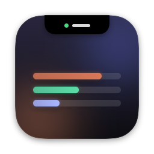
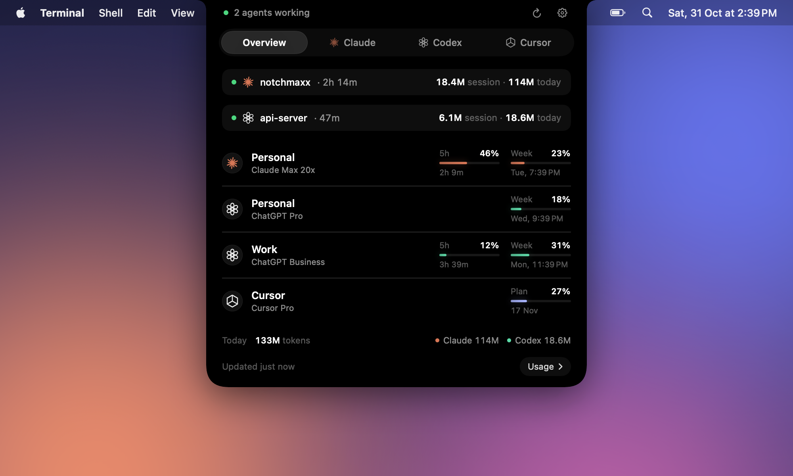
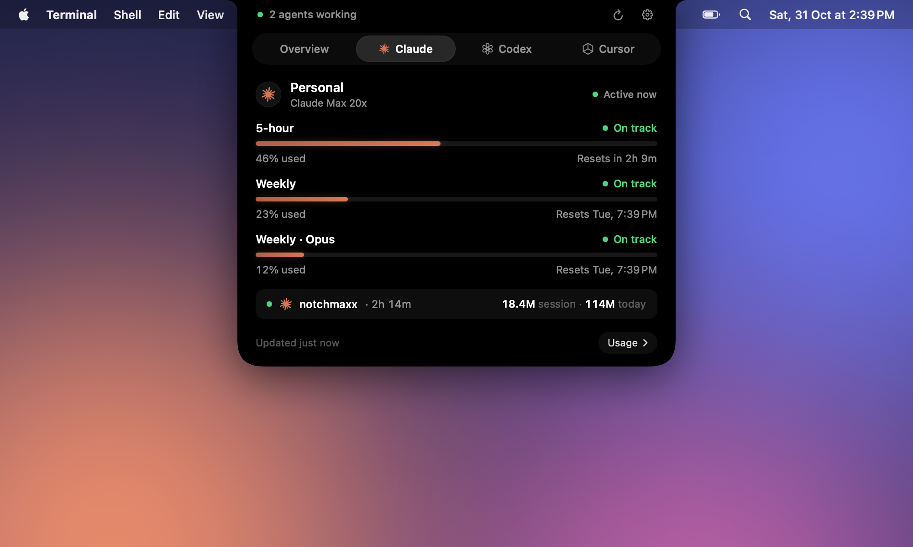
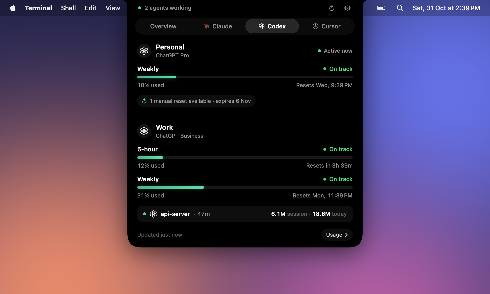
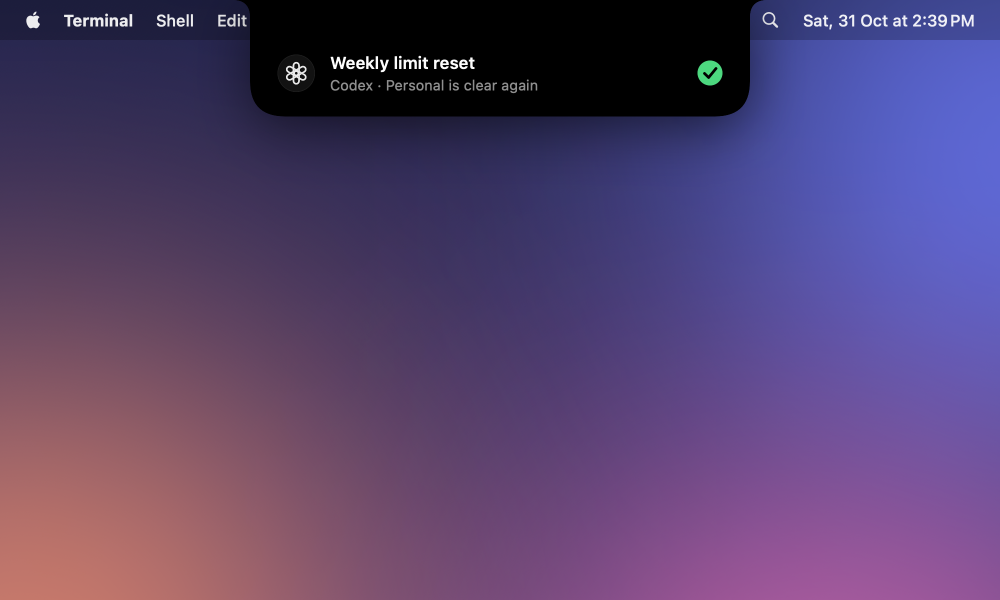
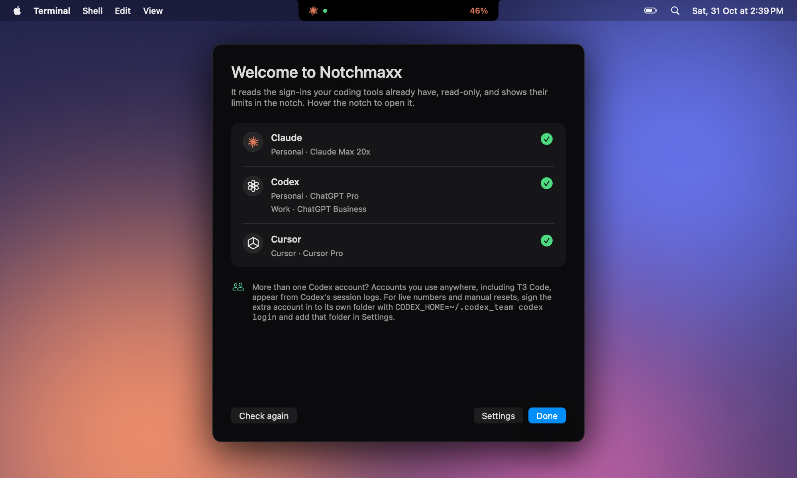

<p align="center">
  
</p>

<h1 align="center">Notchmaxx</h1>

<p align="center">
  Your Claude Code, Codex and Cursor limits, live in the MacBook notch.<br>
  Hover to see every account, when each limit resets, and what you have left to spend.
</p>

<p align="center">
  
</p>

Plans like Claude Max and ChatGPT Pro reset every few hours. Whatever you didn't use in a window is gone. Notchmaxx keeps the numbers one hover away, so you can see a reset coming and queue up the heavy work before it lands.

## Features

- An overview of every connected account on hover, with tabs for Claude, Codex and Cursor. Scroll over the panel to switch tabs.
- The 5-hour and weekly windows, any model-specific caps, and when each one resets.
- A pace check on every window: on track, ahead of pace, or when you'll run out at your current rate.
- Codex manual resets you have left, and when they expire.
- More than one account per tool, such as a work and a personal Codex login, each with a name you choose.
- A small pill beside the notch while an agent is working, plus a live session row with the project, running time and tokens.
- Alerts that drop down from the notch at 75%, 90% and 100%, and again the moment a window resets.
- A usage window with a 7-day token chart and a 30-day breakdown by model, built from Claude Code and Codex logs on your Mac.

<p align="center">
  
  
</p>
<p align="center">
  
  
</p>

The screenshots use made-up demo accounts.

## Requirements

- macOS 14 or later. A MacBook with a notch looks best; on other displays the panel opens from the top center of the screen.
- At least one of: [Claude Code](https://docs.anthropic.com/en/docs/claude-code) signed in with a Claude plan, [Codex](https://github.com/openai/codex) signed in with ChatGPT, or [Cursor](https://cursor.com).
- The Xcode Command Line Tools to build (`xcode-select --install`). Full Xcode isn't needed.

## Build and run

```sh
git clone https://github.com/HimanshuRattan/notchmaxx.git
cd notchmaxx
scripts/build.sh
open build/Notchmaxx.app
```

The first launch opens a setup screen that shows what Notchmaxx found. Move `build/Notchmaxx.app` to `/Applications` if you want **Open at login** to work.

There's no prebuilt download yet. The app is signed ad hoc on your machine by the build script, so macOS doesn't quarantine it.

## How it works

Notchmaxx reads the sign-ins your tools already have and calls the same usage endpoints those tools call. It never refreshes, rotates or writes a token, so it can't sign a tool out, and it never writes to another tool's files.

| Tool | Limits | Tokens and sessions |
| --- | --- | --- |
| Claude Code | The usage cache in `~/.claude.json`. When it's stale, `api.anthropic.com/api/oauth/usage` with Claude Code's keychain sign-in. | `~/.claude/projects/**/*.jsonl` and `~/.claude/sessions` |
| Codex | `chatgpt.com/backend-api/wham/usage`, the endpoint behind `/status`, with `auth.json` from each `CODEX_HOME`. Rate-limit snapshots in the session logs cover accounts that aren't signed in here. | `$CODEX_HOME/sessions/**/rollout-*.jsonl` |
| Cursor | `cursor.com/api/usage-summary`, which Cursor's dashboard uses, with the token from the Cursor app or CLI. | None, because Cursor keeps no local logs |

### Privacy

- Network requests go only to Anthropic, OpenAI and Cursor, and only to read usage. There's no analytics, telemetry or third-party server.
- Tokens stay in memory. They're never logged or written to disk.
- Notchmaxx keeps a scan cache in `~/Library/Application Support/Notchmaxx/` so it doesn't re-read every log on launch. The cache holds token counts, session ids and project folder paths. Settings, including the account names you choose, live in the app's preferences.

### Keychain prompts

Claude Code and the Cursor CLI keep their sign-ins in the macOS keychain. Notchmaxx reads them with Apple's `security` tool.

- Claude Code writes its item with that same tool, so reading it usually doesn't prompt.
- For Cursor, Notchmaxx tries the Cursor app's own token store first, which needs no prompt. It only asks the keychain when that's missing or expired, for example if you use only the CLI.

If macOS asks, **Allow** works for the session. **Always Allow** adds `security` to that item's access list, which lets any process that runs `security` read it without asking. Choose what fits your threat model.

### More than one Codex account

Each Codex login lives in its own `CODEX_HOME` folder. To track a second account live, including its manual resets, sign it in to a separate folder and add that folder under **Settings → Sources**:

```sh
CODEX_HOME=~/.codex_work codex login
```

Accounts used elsewhere still show up from Codex's session logs, with less detail. Codex logs don't reliably record which account ran a thread, because some clients switch accounts mid-thread, so log data is grouped by plan and matched to your signed-in accounts. Two accounts on the exact same plan merge in log data.

## Caveats

- These usage endpoints aren't public APIs. If a provider changes one, Notchmaxx shows an error for that provider rather than guessing, until it's updated.
- Pace checks project your current rate forward. They're a guide, not a promise.
- Notchmaxx isn't affiliated with or endorsed by Anthropic, OpenAI or Anysphere. Claude, Codex and Cursor are trademarks of their owners.

## Development

```sh
scripts/build.sh debug             # unoptimized build with symbols
build/Notchmaxx.app/Contents/MacOS/Notchmaxx --dump
```

`--dump` prints the accounts, sessions and token totals the app sees, including account emails, so run it from the app bundle to pick up your settings. Add `--offline` to skip network calls. Other flags render images:

| Flag | Output |
| --- | --- |
| `--render <dir>` | A PNG of every panel state, from your own data |
| `--shots <dir>` | Share-ready screenshots, from demo data |
| `--video <file.mp4>` | A 32-second promo with a synthesized soundtrack, from demo data |
| `--video-stills <dir>` | Sample frames of the promo |

The source is in `Sources/Notchmaxx`:

- `App`: app lifecycle, the notch window and the command-line modes
- `Data`: readers for each tool, the log scanner and the store that combines them
- `Model`: shared types and settings
- `UI`: SwiftUI views
- `Promo`: demo data, the promo video and its soundtrack

The build script calls `swiftc` directly because SwiftPM can't link package manifests with some Command Line Tools installs. `Package.swift` is there for editors. For the same reason, views use a small `Box` object instead of `@State`, whose macro plugin ships only with full Xcode.

Issues and pull requests are welcome. If a provider changes its usage format, a `--dump` from the bundled app (with emails removed) is the most useful thing to include.

## License

[MIT](LICENSE)
